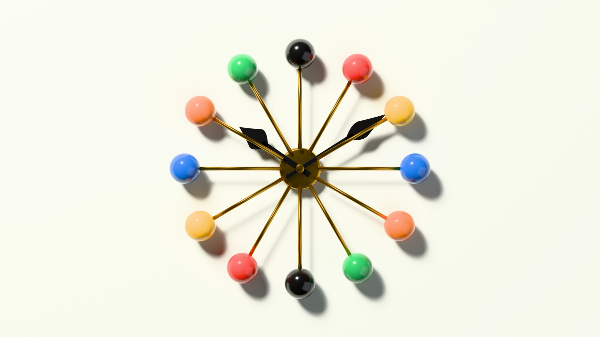
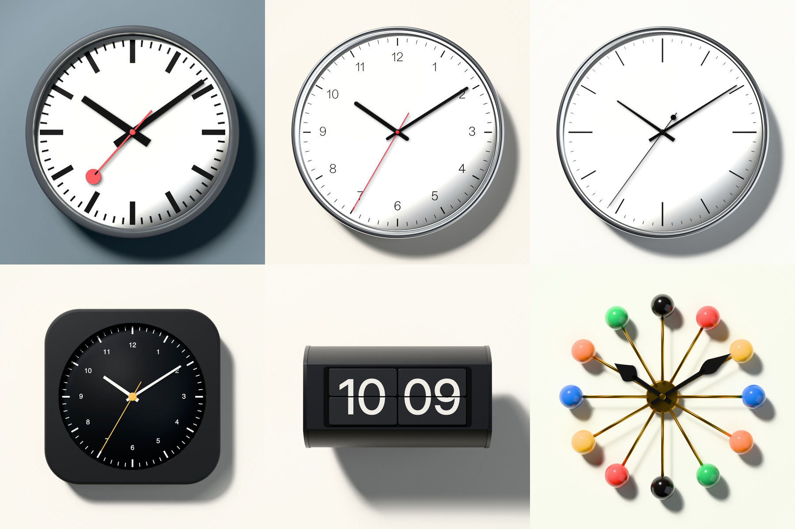
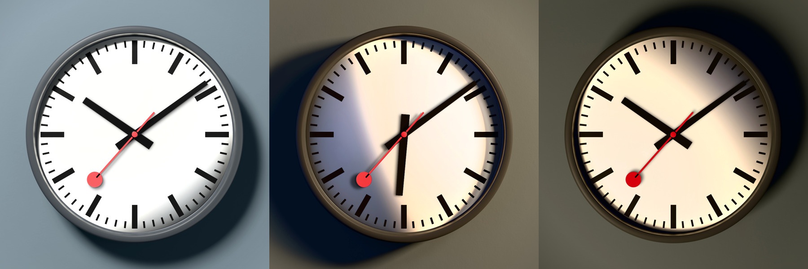
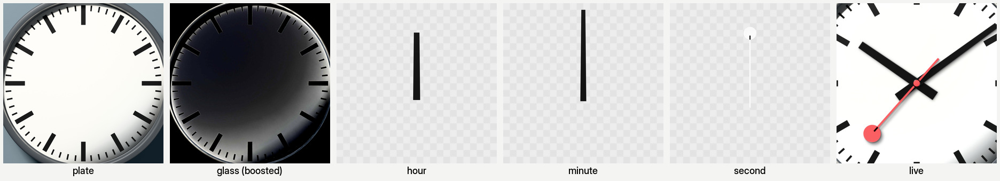
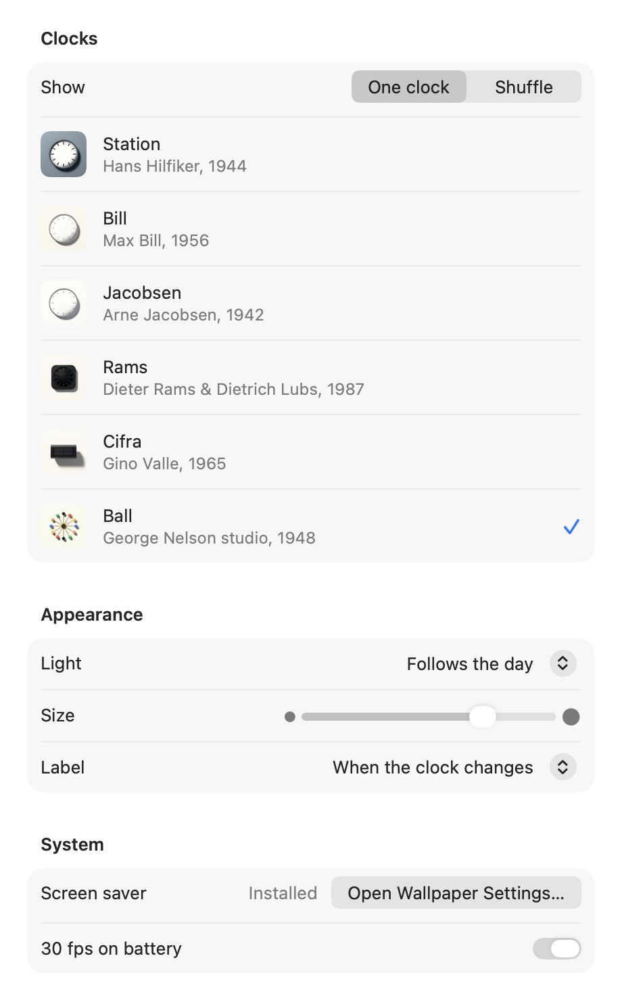

# Legendary Clocks

A macOS app and screensaver of six design-history clocks. Each clock is modelled and lit in Blender, then animated live on the Mac with Core Animation.



**Site:** https://claude.ai/artifact/KFkjmGgYfZyddSDUMYuKqw

The clocks are approximations, made for personal use and credited to their designers. They are not official or licensed products.

## The clocks



| Clock | After | Year | Movement |
| --- | --- | --- | --- |
| Station | Hans Hilfiker, Swiss railways | 1944 | The second hand sweeps the dial in 58.5 s and waits at 12. Then the minute hand jumps and settles. |
| Bill | Max Bill, for Junghans | 1956 | Quartz tick |
| Jacobsen | Arne Jacobsen, Aarhus City Hall | 1942 | Smooth sweep |
| Rams | Dieter Rams and Dietrich Lubs, for Braun | 1987 | Quartz tick |
| Cifra | Gino Valle, for Solari | 1965 | Flip cards turn over on the minute |
| Ball | George Nelson studio | 1948 | Smooth sweep |

Each clock was chosen for a different idea of what a clock face is: a railway signal, Bauhaus numerals, an architect's minimal dial, a Braun product, a mechanical flip display and a mid-century sculpture. A seventh clock (the Orsay museum clock) was modelled and then dropped. It looked baroque next to the others.

## How it works

### 1. Model

Each clock is one Python script in `studio/clocks/`. It builds the clock in Blender from measured proportions: case, bezel, dial, raised markers, layered hands and glass. Nothing is sculpted by hand, so a change is one edit and one re-render. Some details:

- Station's markers are raised 0.3 mm with 0.12 mm bevels, and the hands sit at three heights above the dial.
- Bill's study version sets the numerals in Inter Display Light, the closest open-licensed match to the originals.
- Cifra is a black cylinder cut flat at the front, with four card halves in a slot. The numerals are not in the render. The app draws them live.

### 2. Light

`studio/rig.py` holds the scene: the wall, the camera and three lighting sets (day, dusk and night). Each set has one large key light at a fixed position in the upper left, a fill light, and low softboxes that give the metal its reflections. Light linking keeps every light except the key out of the glass, so the glass shows one soft reflection and the dial stays readable. A clock can change a set's light size, power or colour, but not its position, because the app calculates the hand shadows from it.



### 3. Split into layers

A clock cannot be rendered once and rotated, because the hands move and the light does not. So each look renders as separate layers:



- **Plate:** the case, dial, markers and wall shadow, with no hands.
- **Glass:** the reflection pass, added on top at a set strength.
- **Hands:** one transparent sprite per hand, rendered pointing at 12.
- **Hand shadows:** a soft and a contact shadow for each hand, made from its outline.

The camera sits on the clock's axis, so turning a hand sprite in 2D is exact. Six clocks, three lights and six layers per look come to about 100 Cycles renders for the full set.

### 4. Animate

The app stacks the layers in Core Animation and turns the hands every frame. Each hand's shadow moves away from the hand by that hand's height above the dial, in the direction of the key light, so the second hand's shadow sits further out than the hour hand's. The glass and the edge fade are baked into the plate once at load, so each frame only moves the hands.

Cifra has no hands. Its numerals and falling flaps are drawn live with Core Text: the top half of the old card folds down, then the bottom half of the new card unfolds below the split.

### 5. Run

The light follows the time of day and crossfades between day, dusk and night. The app can show one clock or shuffle through them. The shuffle is calculated from the time, so the app, the screensaver and each display agree without talking to each other. Each round through the clocks is a new random order, and the same clock never shows twice in a row.

## Mac app



```sh
cd mac
./build.sh        # needs the Xcode command line tools; there is no Xcode project
open "build/Legendary Clocks.app"
```

The rendered clocks are in the repo, so you do not need Blender to build the app.

| Key | Action |
| --- | --- |
| 1 to 6 | Show a clock |
| ← → | Previous or next clock |
| S | Shuffle on or off |
| L | Change the light |
| C | Show or hide the label |
| F | Full screen |
| ⌘, | Settings |

To use the screensaver, choose **Install Screen Saver…** in the app menu. Then choose Legendary Clocks in System Settings → Wallpaper → Screen Saver. The screensaver uses the choices from the app's Settings window.

Requires an Apple Silicon Mac with macOS 14 or later. The build is signed ad hoc. On first launch, macOS blocks it: open it from System Settings → Privacy & Security.

### Notes on the screensaver

Apple's host for third-party screensavers (`legacyScreenSaver`) has been unreliable since macOS Sonoma. It does not send `stopAnimation`, it keeps dismissed views running, and the process does not exit. The screensaver works around this:

- Every view stops when the system posts `com.apple.screensaver.willstop`, or when the view leaves its window.
- The process exits one second after the session ends.
- The app installs the screensaver by removing the old bundle, copying the new one and restarting the host. A copy over a loaded bundle keeps the old code running. At launch the app checks a SHA-256 digest and replaces a stale copy.
- The screensaver runs in a sandbox, so the app owns the settings. It writes them to `~/Library/Application Support/Legendary Clocks/settings.json`, which the host can read.

The host draws the whole screen every frame, so frame rate is the main power control. The app and screensaver run at 30 fps on battery or in Low Power Mode, and at the display's maximum otherwise. The clock moves by about 1% of the screen on a slow path, so no pixel stays lit on an OLED display.

## Render it yourself

```sh
cd studio
./render_wall.sh station "day dusk night"    # plate, glass and hand layers for one clock
cd ../mac && ./assets.sh && ./build.sh        # copy the renders into the app and rebuild
```

Needs Blender 4.2 or later (Cycles) and ImageMagick. A full look takes about 5 minutes on an M-series Mac. Run one Blender job at a time: two at once can run out of GPU memory.

Other scripts:

- `render_view.sh`: a full-object view for the web page (`LENS`, `CROPM`, `NAME`, `TREATMENT`).
- `render_face.sh`: a dial-only view.
- `render_approval.sh`: full 3D reference frames, a close-up and a motion sample for lighting reviews.
- `pack_angles.py`: packs hand renders at many angles into strips, for a future version where the highlights stay fixed while the hands turn.

`TREATMENT=study` renders the art-directed version of a clock. Bill is the first: an ivory room, a 50 mm lens with more space around the object, and a large soft key for a quiet wall shadow.

## Layout

| Folder | Contents |
| --- | --- |
| `mac/Engine/` | Clock scene, movements, assets, settings and shuffle. Shared by the app and the screensaver. |
| `mac/App/` | Window, menus, keys and the SwiftUI Settings window |
| `mac/Saver/` | The screensaver |
| `mac/Resources/` | Rendered clocks and `clocks.json` (names, sizes, hand heights, light schedule) |
| `studio/` | Blender rig, clock models and render scripts |
| `site/` | The product page |
| `docs/` | Images for this README |
| `maxbill/` | The first sculpt |

## Fonts

| Use | Font | Licence |
| --- | --- | --- |
| Bill numerals, study version | Inter Display Light, `studio/fonts/` | SIL Open Font License 1.1 |
| Bill numerals, current app renders | ABC Diatype Light Trial, not included | Trial licence. To replace with the study version. |
| Cifra numerals and the app label | Inter Display Medium | SIL Open Font License 1.1 |
| Rams numerals | Helvetica (macOS system font), not included | To replace |

## Status

- The app, screensaver, shuffle and Settings window work.
- A second lighting pass (fixed highlights as the hands turn, softer wall shadows) has reference frames for Station and Bill. It is not yet in the app.
- Cifra stands about 7 cm off the wall, so its dusk and night shadows look detached.

Built by Andy Bird with Claude Code. Blender for the renders, Swift and Core Animation for the app.
